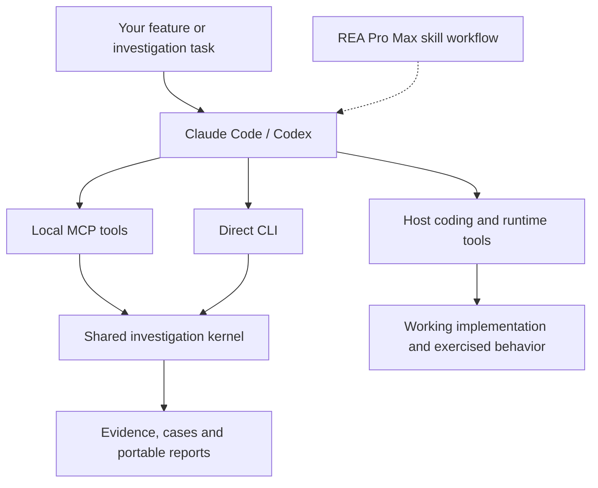

# REA Pro Max

## Recover the behavior. Ship the proof.

**Turn an unfamiliar feature into a working implementation you can explain, exercise and verify.**

REA Pro Max is an independent reverse-engineering toolkit with a local MCP server, an agent skill and a direct CLI. Built for Claude Code, Codex and compatible MCP clients, it connects artifact analysis to experiments, implementation and finite behavioral verification. Version 0.4 adds a bounded web recovery lane and an optional pinned Craft Anything provider on top of the documented MV3 loop: run a real extension, reproduce its persistence failure, repair a receiving project and replay the same actions with retained evidence.

[English](README.md) · [Tiếng Việt](docs/i18n/vi.md) · [한국어](docs/i18n/ko.md) · [日本語](docs/i18n/ja.md) · [Español](docs/i18n/es.md) · [Português](docs/i18n/pt-BR.md) · [简体中文](docs/i18n/zh-CN.md) · [ไทย](docs/i18n/th.md) · [Français](docs/i18n/fr.md)

[Explore the recorded lab](https://hieunguyenak92.github.io/rea-pro-max/#explorer) · [Connect MCP](docs/MCP.md) · [Install the skill](docs/INSTALL.md) · [Verification record](docs/VALIDATION.md) · [Releases](https://github.com/hieunguyenak92/rea-pro-max/releases)


*An actual standalone report from the owned synthetic lab. Its worker execution uses simulated Chrome APIs; separately exercised app observations are documented below.*

## The valuable part lives beneath the interface

You can see the button. The hard questions come after the click.

Where does its message go? Which process owns the state? What survives a restart? What does cancellation interrupt? What happens when a receiver disappears? Which error reaches the caller? Why does a feature that worked once fail on the second attempt?

Those details decide whether a recovered feature feels dependable in a real product.

REA Pro Max brings them into the development loop. Inspect the artifact, map the relevant boundaries, declare competing explanations and choose an experiment that separates them. Implement the selected behavior in your project. Compare outputs, state, effects and traces. When a discrepancy survives, reduce it to a smaller reproduction.

**The destination is the requested working feature, supported by evidence.** Your host agent writes and runs the implementation; REA Pro Max supplies inspectable analysis and decision machinery for the investigation around it.

## What can you ask it to do?

| Your job | What a useful handoff contains |
| --- | --- |
| Rebuild a web search interaction | Runnable search code, normalization and ordering rules, checked inputs and remaining differences. |
| Recover an extension's save/restore feature | Popup/content/worker/storage boundaries, selected persistence contract and runtime cases the host actually exercised. |
| Understand an Electron export flow | Main/preload/renderer candidates, observed request/response behavior and a working implementation of the selected feature. |
| Explain a regression between two builds | Comparable receipts, a concrete mismatch and the affected observable behavior. |
| Shrink a recurring failure | A smaller action sequence that preserves the stable failure fingerprint, with a bounded reduction record. |
| Investigate an unfamiliar target family | A scoped plan executed with available host tools, precise prerequisites and explicit unsupported claims. |

Start with one feature and a receiving project. The agent prepares the internal case files; you can ask in ordinary language.

```text
Use REA Pro Max to investigate this extension's save-and-restore behavior and
implement it in my project. Trace popup, content script, worker and storage
boundaries. Check persistence under a qualified worker restart, preserve error
behavior, and deliver runnable code with the exact cases exercised and remaining
unknowns.
```

## One toolkit. Three ways to work.

Requires **Node.js 22+**. The runtime ships its parser and MCP SDK bundle. No runtime npm install, model API key or upstream REA server is required. Your AI host has its own account and tool requirements.

The commands below use the **Git checkout layout**:

```sh
git clone https://github.com/hieunguyenak92/rea-pro-max.git rea-pro-max
cd rea-pro-max
```

**Using the packaged skill ZIP?** Its extracted `rea-pro-max/` folder is the skill root: run `node scripts/rea-pro-max.mjs demo --out ./rpm-lab` there, use `/absolute/path/to/rea-pro-max/scripts/mcp-server.mjs` for MCP, and copy that whole folder when installing the skill. [Layout and ZIP commands](docs/INSTALL.md#choose-your-package-layout). GitHub’s automatic source-code archives retain the checkout layout.

### How the pieces work together



The same kernel serves both tool paths. The host agent connects the investigation to the code it writes and the runtime cases it exercises.

### 1. Connect your agent through MCP

REA Pro Max exposes 21 focused tools over local stdio. The server receives an explicit existing workspace; client-selected files and exports stay inside that boundary.

Claude Code registration, using your actual absolute paths:

```sh
claude mcp add --transport stdio --scope local rea-pro-max -- node "/absolute/path/to/rea-pro-max/skills/rea-pro-max/scripts/mcp-server.mjs" --workspace "/absolute/path/to/your-workspace"
```

Codex registration:

```sh
codex mcp add rea-pro-max -- node "/absolute/path/to/rea-pro-max/skills/rea-pro-max/scripts/mcp-server.mjs" --workspace "/absolute/path/to/your-workspace"
```

To enable the opt-in Chromium provider, append an explicit executable path when registering the server:

```sh
codex mcp add rea-pro-max -- node "/absolute/path/to/rea-pro-max/skills/rea-pro-max/scripts/mcp-server.mjs" --workspace "/absolute/path/to/your-workspace" --browser "/absolute/path/to/chromium"
```

Runtime is disabled when `--browser` is omitted. The selected browser is launched with a disposable profile; it is not an OS or network sandbox.

These commands are setup instructions for you to run; the product does not automatically modify another application's configuration. Reconnect the client, confirm the tool list and ask it to call `get_capabilities`. See [MCP setup, configuration examples and execution policy](docs/MCP.md).

### 2. Add the skill to a normal coding task

Copy the complete `skills/rea-pro-max` folder to a skill location recognized by your host:

| Host | Project location |
| --- | --- |
| Claude Code | `.claude/skills/rea-pro-max` |
| Codex | `.agents/skills/rea-pro-max` |

Then use `/rea-pro-max` in Claude Code, or select/mention `$rea-pro-max` in Codex, followed by your task. The skill adds the investigation-to-implementation workflow and uses available host tools. MCP supplies structured tools; the skill supplies task instructions. Either path can use the direct CLI when terminal access is available.

The [installation guide](docs/INSTALL.md) includes guarded copy commands, Windows instructions and personal skill locations.

### 3. Run the executable toolkit directly

```sh
node skills/rea-pro-max/scripts/rea-pro-max.mjs demo --out ./rpm-lab
```

Open `rpm-lab/report.html` in your browser. No report server or CDN is needed. Choose a fresh output path for each run; existing generated outputs are not silently overwritten.

Then inspect the included artifact yourself:

```sh
node skills/rea-pro-max/scripts/rea-pro-max.mjs inspect ./rpm-lab/fixtures/mv3/reference --out inspection.json
node skills/rea-pro-max/scripts/rea-pro-max.mjs report inspection.json --out inspection.html
node skills/rea-pro-max/scripts/rea-pro-max.mjs prompts --target mv3
```

## A save that survives a real worker restart

A warm demo can hide a persistence bug. The v0.4 recovery project makes it observable: the starter saves successfully, survives reopening its page, then loses the acknowledged value when Chromium actually stops and wakes the worker.

```sh
node skills/rea-pro-max/scripts/rea-pro-max.mjs recovery init --out ./recovery-work
node skills/rea-pro-max/scripts/rea-pro-max.mjs runtime doctor --browser "$RPM_BROWSER"
node skills/rea-pro-max/scripts/rea-pro-max.mjs recovery replay --reference ./recovery-work/reference --candidate ./recovery-work/starter --scenario ./recovery-work/scenario.json --browser "$RPM_BROWSER" --out ./before.json
```

Set `RPM_BROWSER` to the absolute executable path of an installed Chromium/Chrome for Testing build that supports unpacked extensions. No browser is silently downloaded. The first replay intentionally exits `2`: its mismatch identifies the failing action and retains both executions. Ask your agent to repair `starter/worker.js` against `starter/contract.json`, then replay with a new output path. The `recovered/` directory is an independently authored, runnable worked example of the receiving implementation.

**The loop ends with source you can run, plus evidence you can inspect.** It does not automatically reconstruct arbitrary extensions. This provider currently exercises the documented `rpm-kv-v1` message protocol and selected reset boundaries. Raw responses preserve boot IDs; comparison excludes only that declared observational field. Message receipts do not attest unobserved UI, network or file effects.

MCP users can enable the same kernel by appending `--browser "/absolute/path/to/chromium"` when registering the server. Runtime is disabled by default. `capture_feature` records one target; `replay_feature` compares reference and candidate in separate disposable profiles. The host agent still writes the repair. [Full recovery workflow and limits](docs/RECOVERY.md) · [Exact verification record](docs/VALIDATION.md).

## Recover a web workflow with evidence

Version 0.4 extends the same discipline to ordinary web applications. Give the CLI or MCP server a bounded scenario and two explicit URLs. It captures finite actions such as navigation, clicks, inputs, reloads and waits in fresh disposable Chromium profiles, then keeps behavioral channels separate from visual artifact hashes. That separation prevents a screenshot resemblance from being mistaken for interaction equivalence.

```sh
node skills/rea-pro-max/scripts/rea-pro-max.mjs web replay \
  --reference-url http://127.0.0.1:4173/reference/ \
  --candidate-url http://127.0.0.1:4174/recovered/ \
  --browser "/absolute/path/to/chromium" \
  --scenario ./web-scenario.json --out ./web-replay.json
```

The result records the URL, title, bounded DOM text/HTML digest, layout width, active element, storage keys, screenshot digest, cleanup and provider identity. Unknown or incomplete cases remain unknown. The bundled `assets/recovery-web/` fixture demonstrates delayed responses, cancellation, latest-wins ordering, Unicode normalization, empty/error states, localStorage persistence, keyboard focus and responsive markup; its `starter` is intentionally defective and `recovered` is independently authored. The fixture's contract is an owned acceptance example, not a claim about arbitrary websites. See [web recovery](docs/WEB-RECOVERY.md).

## Optional Craft Anything bridge

Craft Anything can supply richer inspected application maps when its own pinned MCP server is installed separately. REA Pro Max invokes only three typed aliases (`js_app_map`, `web_site_capture`, `app_graphs_compare`) after a fresh MCP handshake and tools-list check. Every result retains the reviewed repository, commit, version, license, executable and cleanup provenance. Missing commit identity, schema drift, malformed output, timeout or path escape fails closed as unknown/error. No Craft code, branding or assets are bundled and no installation is performed. Read [provider boundaries](docs/PROVIDERS.md) before enabling it.

## A lab with a question worth answering

**A saved decision appears in the popup. Will it still exist after the worker restarts?**

The owned persistence lab contains reference and intentionally regressed worker scripts. Its declared explanations include worker memory, persistent extension storage and an unmodeled mechanism. Reopening the popup gives no distinguishing gain for the two known explanations. Resetting the modeled worker context can separate them.

The lab runs the owned scripts, records their different observable results and reduces the failing sequence to `save → restart → read`. The workbench exposes the artifact boundaries, source evidence, ranked experiments, finite verdict and reduction receipts.

This is a **controlled JavaScript model with simulated Chrome APIs**. It does not establish actual Chromium suspension, natural idle behavior or a real extension lifecycle pass. A genuine browser observation needs the appropriate host controls and a qualified changed worker identity. The [verification record](docs/VALIDATION.md) keeps that distinction explicit.

You can also ask the MCP client to call `run_owned_lab`, inspect the saved handle and export the result. That tool executes only bundled owned lab code.

## Worked results you can inspect

### Recovered search behavior

The [receiving search implementation](examples/recovered-search/CONTRACT.md) reconstructs the owned web fixture's selected search contract: NFKC normalization, locale-aware lowercasing, substring matching, stable record order and string IDs. Accents and whitespace retain their declared meaning.

The reference and receiving app were launched separately. The verification record describes observed Unicode cases and the finite component checks. This is a worked example authored and checked with source access; it is not a blinded study or a measured claim that installing a skill caused an improvement.


### Electron export boundary

The owned Electron fixture was exercised through renderer → preload bridge → `ipcRenderer.invoke` → main handler. Its local JSON export was read back and checked. Static analysis separately identifies candidate boundaries; the runtime observation supplies the exercised behavior.


For versions, platforms, exact operations and unverified targets, read [VALIDATION.md](docs/VALIDATION.md). Screenshots show actual pages/apps, not generated product mockups.

## Expert decisions, encoded as inspectable machinery

### 1. Analyze the boundary that matters

The Acorn-based reader separates relevant web, MV3 and extracted Electron contexts. Records retain source ranges, file digests and evidence IDs. Communication edges carry declared/candidate authority.

That distinction matters when the same message string appears in several contexts. A name match suggests a relationship to investigate; runtime delivery still needs an observation. Dynamic expressions, missing imports and unsupported syntax remain visible as unknowns.

`inspect` parses the admitted artifact without executing its JavaScript. Explicit include/exclude prefixes let you select the relevant files; coverage records identify admitted, omitted and unparsed sources. A reachable TypeScript/JSX file remains visible as unsupported instead of silently disappearing. Source evidence can be read as a bounded snippet after checking its file hash. Inventory and graph limits keep scope bounded; exceeding a hard limit tells you to narrow the input.

### 2. Choose a test for its ability to distinguish explanations

The planner operates on explicit hypotheses and predicted outcomes. It ranks the worst-case number of alternatives eliminated per declared cost:

```text
score = (surviving hypotheses − worst-case survivors) / declared probe cost
```

Capabilities, allowed effects and budget filter the available recipes first. Missing predictions survive conservatively; nondeterministic outcome sets remain possible. Incompatible or partial observations do not eliminate hypotheses.

If the supplied model cannot explain a qualified observation, the result can be `model_incomplete`. If no admissible experiment distinguishes the remaining alternatives, it can be `no_discriminating_probe`. These states preserve the next decision instead of inventing confidence percentages.

### 3. Keep observations bound to the investigation they describe

A useful receipt needs the target, scenario, reset and toolchain identity. Verification also binds the verifier identity. When those change, old observations may no longer answer the current question.

Case revisions make updates explicit. The MCP process checks expected revisions before committing changes. Observations retain their supplied authority and source. Content digests identify bytes; they do not authenticate a caller's runtime claim.

### 4. Verify the behavior you selected

The finite verifier compares outputs, state, effects and optional event traces. Duplicate events and relevant ordering remain significant. Total-order and per-channel trace contracts make the allowed interleaving explicit.

Normalization is restricted to declared metadata paths. It cannot erase differences in the primary output, state, effects or trace. Results distinguish `pass`, `fail` and `unknown`; missing cases or incomparable resets cannot silently become success.

A finite pass concerns the supplied comparable cases. It does not establish whole-program equivalence or independently attest that either runtime ran.

### 5. Reduce the failure while retaining its identity

The CLI reducer removes actions within a declared oracle-call budget. It repeats checks, supports reset before each attempt and keeps the original mismatch fingerprint. Invalid candidates, unstable outcomes, unknown results and exhausted budgets remain visible.

Tested one-minimality applies to the removal operations actually checked. It is not a guarantee of the globally shortest reproduction. The generic `shrink` CLI explicitly executes your owned `.mjs` oracle in a fresh child process for each trial, with a configurable deadline and bounded output. A fresh process resets module memory; an optional oracle `reset()` owns external state. This is an execution boundary, not an OS sandbox. MCP does not expose arbitrary oracle execution.

### 6. Make the investigation portable

The workbench is a standalone HTML viewer with working search, context filters, evidence selection and full JSON export. Records remain readable independently of the interface.

MCP returns bounded summaries and session handles, then pages the selected sections. Export saves JSON or HTML to a new workspace path. Session handles live only for the server process; exported case files can be imported when resuming an investigation.

## What v0.4 supports

| Area | Built-in capability | Boundary |
| --- | --- | --- |
| JavaScript/web artifacts | Bounded source inventory, AST analysis, contexts and candidate relationships | Local files/extracted sources; dynamic behavior requires host observations. |
| Manifest V3 | Static contexts plus optional actual Chromium capture/replay for the documented `rpm-kv-v1` message protocol | Requires an explicit Chromium executable and an extension implementing that protocol. Other extensions need an appropriate adapter. |
| Web recovery | Bounded action capture/replay with DOM, state, storage, network summaries and separate visual hashes | Requires an explicit Chromium executable and URLs/scenarios supplied by the host; finite evidence is not whole-app equivalence. |
| Craft Anything provider | Optional pinned MCP adapter for typed application maps, web capture and graph comparison | Requires a separately installed, caller-selected binary matching the pinned version/commit; core REA Pro Max works without it. |
| Extracted Electron | Main/preload/renderer and candidate IPC boundaries | Installed package extraction and runtime controls are separate prerequisites. |
| Investigation kernel | Cases, probe ranking, finite verification and bounded reduction | Works on declared models/receipts; evidence quality remains explicit. |
| MCP | Local stdio, 21 tools, workspace-scoped input/export, web replay and an optional pinned Craft provider; no arbitrary shell/oracle tool | Runtime capture/replay is disabled until `--browser` is configured. No arbitrary shell/oracle tool. |
| Native/managed/mobile and other families | Task prompts for appropriate host tools; limited format classification where implemented | No bundled universal decompiler, mobile runtime or semantic recovery engine. |

## MCP tool catalog

| Tool | Purpose |
| --- | --- |
| `get_capabilities` | Inspect version, scope, workspace, limits and execution policy. |
| `inspect_artifact` | Analyze an admitted artifact and retain the complete result behind a handle. |
| `read_artifact` | Page selected sections without dumping the entire graph into every response. |
| `read_source_evidence` | Retrieve a bounded, hash-checked source snippet for an evidence record. |
| `capture_feature` | With runtime enabled, capture a declared MV3 message/reset scenario in actual Chromium. |
| `replay_feature` | Run reference and receiving extensions separately; retain finite verdict and mismatch evidence. |
| `capture_web` | Capture a bounded web action scenario in actual Chromium. |
| `replay_web` | Replay two explicit web URLs and compare behavior separately from visual hashes. |
| `craft_provider_doctor` | Handshake with the pinned optional Craft Anything MCP provider. |
| `craft_provider_inspect` / `craft_provider_capture` / `craft_provider_compare` | Call only the typed Craft aliases and retain provider provenance. |
| `create_case` | Start from an inspection's actual target identity and a chosen goal. |
| `revise_case` | Validate a bounded model update against the expected revision. |
| `record_observation` | Append provenance-bearing observations with explicit revision checks. |
| `rank_probes` | Rank admissible experiments through the conservative kernel. |
| `verify_behavior` | Compare workspace receipt files under a finite contract. |
| `export_artifact` | Write JSON or standalone HTML to a new workspace file. |
| `run_owned_lab` | Execute the bundled controlled worker model and retain its real results. |
| `list_task_prompts` | Browse the 36 task templates by family and page. |
| `import_case` | Resume from a validated exported case file. |

The client's discovered schemas are the exact argument contract. [MCP.md](docs/MCP.md) documents setup, a first tool sequence, session lifetime and failure handling. Tool annotations describe intent; path checks and server validation enforce the actual boundary.

## CLI and portable case files

```sh
node skills/rea-pro-max/scripts/rea-pro-max.mjs help
node skills/rea-pro-max/scripts/rea-pro-max.mjs case init --inspection inspection.json --goal "Explain persistence" --out case.json
node skills/rea-pro-max/scripts/rea-pro-max.mjs case revise case.json --patch experiment.json --revision 1
node skills/rea-pro-max/scripts/rea-pro-max.mjs plan case.json --bindings bindings.json --budget 10 --out plan.json
node skills/rea-pro-max/scripts/rea-pro-max.mjs verify --reference reference.json --candidate candidate.json --contract contract.json --out verdict.json
node skills/rea-pro-max/scripts/rea-pro-max.mjs shrink --input actions.json --oracle ./owned-oracle.mjs --max-tests 100 --timeout-ms 10000 --out reduced.json
```

Prepare the patch, bindings, receipts, contract and owned oracle before running their commands. [Case format](skills/rea-pro-max/references/case-format.md) and [verification format](skills/rea-pro-max/references/verification.md) specify the data. The agent normally writes these files for your task.

Verifier exit codes are `0` for pass, `2` for mismatch and `3` for incomplete/incomparable evidence; command/input errors return `1`. A valid finite mismatch is a result, not an MCP transport failure.

## 36 prompts for concrete jobs

The catalog covers web, MV3, Electron, Tauri, Android, React Native, Flutter, Apple, managed/native, WebAssembly and cross-target tasks. Its value is in the requested outputs and expert questions: cancellation, correlation, Unicode, persistence, IPC, errors and comparable resets.

```sh
node skills/rea-pro-max/scripts/rea-pro-max.mjs prompts --target electron
```

Templates direct the host agent; they are not provider implementations or task-success measurements. Deeper native/mobile analysis requires actual suitable host tools. Read the [prompt guide](skills/rea-pro-max/references/prompt-library.md) and [target scope](skills/rea-pro-max/references/target-analysis.md).

## Your result stays inspectable

The demo emits `inspection.json`, `case.json`, `planner.json`, `reference.json`, `candidate.json`, `verification.json`, `reduction.json`, `lab.json` and `report.html`. A rebuild handoff should additionally contain runnable source, its launch command, the selected contract, operations actually exercised and remaining limits.

The bundled CLI/MCP server has no telemetry uploads or model API calls. MCP uses local stdio. Optional runtime operations launch Chromium with a loopback debugging endpoint and a disposable profile; the selected extension/browser can make network requests under their own permissions. Your AI host and external runtime tools retain their own data policies. Reports can contain paths, code and observed values; review them before sharing. See [privacy and execution boundaries](docs/PRIVACY.md).

## FAQ

**Can I just ask Claude or Codex to use it?** Yes. Install the skill or connect the MCP server, supply the target and requested result, then assign the task. Actual app/device work needs available host tools.

**Does it write the recovered feature?** The skill directs the host agent to implement and run the requested feature in your project. The toolkit supplies analysis and verification operations. A report alone does not complete a rebuild request.

**Does it decompile any app?** Built-in analysis specializes in JavaScript/web/MV3/extracted Electron. Other target families require appropriate external tools. The support table describes what ships.

**Are MCP and the skill both required?** No. MCP exposes structured tools; the skill supplies the workflow. The CLI remains directly usable, and upstream REA is not required.

**Is the lab a real Chromium worker test?** The original `demo` and `run_owned_lab` use simulated Chrome APIs. The separate v0.4 runtime capture/replay path runs actual Chromium. Its lifecycle receipts distinguish page reopen, forced worker stop and qualified natural idle; see the exact browser/version evidence in the verification record.

**Does `pass` prove the entire rebuilt app is equivalent?** No. It covers the declared comparable finite cases and contract. Missing/incomplete evidence can produce `unknown`.

**Will my case survive an MCP restart?** Export it before shutdown, then use `import_case` in a new session. Session handles are process-local and bounded.

**Is target code executed during inspection?** No. `runtime capture`, `recovery replay` and the opt-in MCP runtime tools explicitly execute the selected extension. The CLI's generic `shrink` executes your supplied oracle. Read the execution policy before choosing the operation.

## Troubleshooting

| Symptom | Next step |
| --- | --- |
| MCP cannot start | Check Node22+, absolute server path and an existing absolute workspace. Use an absolute Node executable if the host has a different PATH. |
| No tools appear | Reconnect the host, inspect its server status and check local/managed MCP permissions. |
| A target is outside the workspace | Select a workspace containing the intended target/output scope, then restart the server. Paths do not grant access by themselves. |
| An input hits a resource bound | Choose a narrower extracted scope; do not interpret a rejected inventory as complete analysis. |
| A handle is unavailable | It may be expired/evicted or belong to another process. Inspect again or import a saved case. |
| A revision update is rejected | Read the latest case and reapply the intended change to its current revision. |
| A verdict is `unknown` | Check case completeness, matching inputs and scenario/reset/toolchain/verifier bindings. |
| An output already exists | Choose a new path. Preserve the earlier evidence rather than silently replacing it. |

## Development and next steps

```sh
npm ci --ignore-scripts
npm test
npm run lint
npm run check:docs
python3 tools/package_skill.py --check
```

Development dependencies are separate from the self-contained runtime. The [verification record](docs/VALIDATION.md) lists what actually passed; available commands alone are not proof.

Future work will be prioritized around real tasks: deeper static resolution with explicit uncertainty, additional reproducible feature-recovery examples, and version-qualified provider integrations where they can be exercised. These are roadmap directions, not shipped support claims.

## Documentation and credits

[Install](docs/INSTALL.md) · [MCP](docs/MCP.md) · [Skill](skills/rea-pro-max/SKILL.md) · [Target scope](skills/rea-pro-max/references/target-analysis.md) · [Lifecycle experiments](skills/rea-pro-max/references/lifecycle.md) · [Verification](docs/VALIDATION.md) · [Privacy](docs/PRIVACY.md)

REA Pro Max is independently developed. Research inspiration and retained dependency notices are recorded in [credits](THIRD_PARTY_NOTICES.md). It is not an official release of another project, and upstream REA is not a mandatory dependency. [MIT license](LICENSE).

**Bring a feature worth understanding. Leave with a result you can inspect.**
