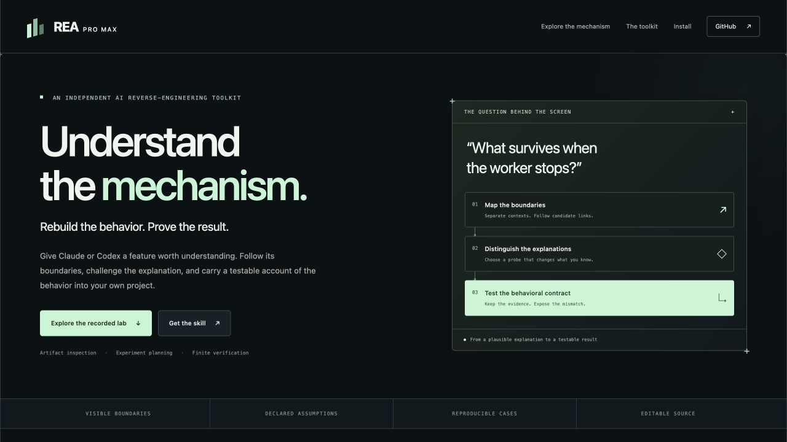

# REA Pro Max

**Thấu hiểu cơ chế. Tái tạo hành vi. Kiểm chứng kết quả.**

Skill và bộ công cụ reverse engineering độc lập dành cho Claude Code và Codex. Biến một app, extension hay tính năng web chưa quen thuộc thành cơ chế có thể giải thích, mã triển khai có thể chạy và tập hành vi có thể kiểm chứng.

[English](README.md) · [Tiếng Việt](README.vi.md) · [한국어](README.ko.md) · [日本語](README.ja.md) · [Español](README.es.md) · [Português](README.pt-BR.md) · [简体中文](README.zh-CN.md) · [ไทย](README.th.md) · [Français](README.fr.md)

[Khám phá bản lab đã ghi lại](https://hieunguyenak92.github.io/rea-pro-max/#explorer) · [Cài skill](docs/INSTALL.md) · [Hồ sơ kiểm chứng](docs/VALIDATION.md) · [Bản phát hành](https://github.com/hieunguyenak92/rea-pro-max/releases)



## Giao diện thuyết phục mới chỉ là điểm khởi đầu

Phần khó nằm sau cú nhấp: context nào nhận thông điệp, trạng thái tồn tại ở đâu, thao tác hủy thực sự dừng điều gì, lỗi nào trả về cho bên gọi và vì sao tính năng vừa dựng lại thất bại ở lần sử dụng thứ hai.

REA Pro Max đưa những câu hỏi đó vào quá trình triển khai. Phân tích JavaScript đã đóng gói. Đặt các giả thuyết cạnh tranh. Chọn phép thử phân biệt chúng. Dựng hành vi được yêu cầu ngay trong dự án của bạn. So sánh đầu ra, thay đổi trạng thái và sự kiện thực tế. Thu gọn lỗi thành chuỗi thao tác vẫn tái hiện đúng sai khác ban đầu.

**Thành phẩm là tính năng chạy được mà bạn yêu cầu, kèm bằng chứng.** Agent trong môi trường của bạn thực hiện việc lập trình và thao tác runtime; bộ công cụ đi kèm cung cấp phân tích, xếp hạng phép thử, đối chiếu hành vi và thu gọn lỗi bằng mã thực thi.

## Gắn skill vào công việc bạn đang làm

Sau khi [cài đặt](docs/INSTALL.md), giao việc bằng ngôn ngữ tự nhiên trong Claude Code:

```text
/rea-pro-max Phân tích cơ chế lưu và khôi phục của extension này rồi triển khai trong dự án của tôi. Lần theo popup, content script, worker và storage. Kiểm tra tính bền vững của dữ liệu sau khi xác nhận worker thực sự khởi động lại, giữ đúng hành vi lỗi và bàn giao mã chạy được, các ca đã kiểm tra cùng phần chưa xác minh.
```

Với Codex, chọn skill hoặc thêm `$rea-pro-max` trước yêu cầu tương tự. Bạn cung cấp mục tiêu và dự án nhận mã; agent chuẩn bị các tệp case nội bộ. Quan sát trình duyệt, app hoặc thiết bị thật cần công cụ tương ứng trong môi trường chạy agent.

Các công việc phù hợp:

- **Tái tạo một tính năng cụ thể** với thứ tự sự kiện, lỗi, hủy và ranh giới lưu trữ đúng yêu cầu.
- **Hiểu extension MV3** qua popup, content, page và worker trước khi sửa đổi.
- **Khôi phục ranh giới Electron** từ mã main, preload và renderer đã giải nén.
- **Tìm nguyên nhân hồi quy giữa hai bản build** bằng đầu vào và hiệu ứng có thể đối chiếu.
- **Thu gọn lỗi tái hiện được** mà vẫn giữ nguyên loại sai khác cần điều tra.

## Chạy thử cơ chế trước khi tin vào lời hứa

Cần **Node.js 22+**. Bộ công cụ chạy trực tiếp, không cần API key, `npm install` hay server REA gốc.

```sh
git clone https://github.com/hieunguyenak92/rea-pro-max.git rea-pro-max
cd rea-pro-max
node skills/rea-pro-max/scripts/rea-pro-max.mjs demo --out ./rpm-lab
```

Mở `rpm-lab/report.html` bằng trình duyệt. Lab tổng hợp do dự án sở hữu chạy worker tham chiếu và worker lỗi trong **mô hình JavaScript được kiểm soát, dùng API Chrome mô phỏng**. Các kết quả phân tích, xếp hạng phép thử, phát hiện sai khác và thu gọn thao tác được kernel tính thật. Lab này **không** chứng minh worker Chromium thực sự bị tạm dừng. Các quan sát runtime riêng được ghi trong [hồ sơ kiểm chứng](docs/VALIDATION.md).

Tự phân tích artifact đi kèm:

```sh
node skills/rea-pro-max/scripts/rea-pro-max.mjs inspect ./rpm-lab/fixtures/mv3/reference --out inspection.json
node skills/rea-pro-max/scripts/rea-pro-max.mjs report inspection.json --out inspection.html
node skills/rea-pro-max/scripts/rea-pro-max.mjs prompts --target mv3
```

Chọn đường dẫn đầu ra mới: công cụ không âm thầm ghi đè kết quả có sẵn. Xem [cài đặt và CLI](docs/INSTALL.md), tài liệu tiếng Anh, để thiết lập môi trường và dùng thêm lệnh.

## Chất xám thể hiện bằng cơ chế có thể kiểm tra

| Năng lực | Giá trị trong thực tế |
| --- | --- |
| Phân tích ranh giới artifact | Parser AST Acorn, context riêng biệt, cạnh giao tiếp ứng viên, vị trí mã chính xác và digest. `inspect` không thực thi mã mục tiêu. |
| Giả thuyết cạnh tranh | Nêu rõ dự đoán và quy trình reset của phép thử, tránh chốt lời giải thích đầu tiên chỉ vì nghe hợp lý. |
| Xếp hạng phép thử thận trọng | Tối ưu số giả thuyết có thể loại trong trường hợp xấu nhất trên chi phí khai báo; lọc theo năng lực, hiệu ứng cho phép và ngân sách. Dự đoán thiếu vẫn là chưa biết. |
| Ràng buộc bằng chứng | Danh tính target, kịch bản, reset và toolchain ngăn quan sát không tương thích làm sai suy luận hiện tại. Hash xác định nội dung, không bảo chứng sự thật runtime. |
| Đối chiếu hành vi hữu hạn | Kết luận `pass`, `fail`, `unknown` trên output, state, effects và trace; giữ sự kiện lặp cùng thứ tự có ý nghĩa. |
| Thu gọn chuỗi lỗi | Loại bớt thao tác trong ngân sách, kiểm tra oracle lặp lại và giữ fingerprint lỗi. Không hứa chuỗi ngắn nhất toàn cục. |
| Workbench cục bộ | HTML độc lập, tìm kiếm, lọc context, chọn bằng chứng và xuất toàn bộ JSON; không cần backend hay CDN. |
| 36 prompt theo nhiệm vụ | Trải rộng web, extension, desktop và mobile, ghi rõ điều kiện cần. Có prompt không đồng nghĩa có provider đã kiểm chứng. |

Planner chọn câu hỏi tiếp theo, không tự chạy phép thử. Verifier so sánh quan sát được cung cấp, không tự xác nhận runtime đã chạy. Skill hướng agent thực hiện phần việc đó và giữ bằng chứng.

## Phạm vi rõ ràng để kết quả có giá trị

**Phân tích tích hợp ở v0.1:** tệp JavaScript và mã web, Manifest V3, Electron đã giải nén. Biểu thức động, cú pháp chưa hỗ trợ, import thiếu và giới hạn tài nguyên được nêu rõ.

**Kernel độc lập provider:** quản lý case, xếp hạng phép thử, đối chiếu hữu hạn, thu gọn chuỗi và báo cáo cục bộ. `shrink` thực thi module oracle `.mjs` do bạn cung cấp; hãy dùng mã do bạn sở hữu và kiểm soát.

**Quy trình nâng cao qua công cụ của host:** thư viện prompt có native, managed, Android, Apple, React Native, Flutter, Tauri và WebAssembly. Phân tích sâu cần công cụ phù hợp thực sự có sẵn. Phiên bản này không tích hợp decompiler đa năng, mobile runtime, bộ giải nén mọi định dạng hay engine khôi phục ngữ nghĩa. Nhận diện định dạng hoặc có prompt không phải bằng chứng tích hợp hoạt động.

CLI không gửi dữ liệu qua mạng hay telemetry. AI host và công cụ ngoài tuân theo chính sách riêng. Report có thể chứa đường dẫn, mã và giá trị nhạy cảm; đọc [quyền riêng tư và ranh giới thực thi](docs/PRIVACY.md), tài liệu tiếng Anh, trước khi chia sẻ.

## Bạn nhận được gì

Một yêu cầu tái tạo cần bàn giao source chạy được, cách khởi chạy, hợp đồng hành vi đã chọn, thao tác thực sự đã thử, tệp bằng chứng và giới hạn còn lại. Kết quả `pass` chỉ áp dụng cho các ca được kiểm tra, không xác nhận tương đương toàn bộ ứng dụng.

Lab xuất `inspection.json`, `case.json`, `planner.json`, `reference.json`, `candidate.json`, `verification.json`, `reduction.json`, `lab.json` và `report.html` độc lập. Bạn có thể xem riêng từng bản ghi, lưu cùng dự án và xuất toàn bộ payload JSON từ workbench.

Tài liệu kỹ thuật tiếng Anh: [Skill](skills/rea-pro-max/SKILL.md) · [Phạm vi mục tiêu](skills/rea-pro-max/references/target-analysis.md) · [Định dạng case](skills/rea-pro-max/references/case-format.md) · [Hợp đồng kiểm chứng](skills/rea-pro-max/references/verification.md) · [Thư viện prompt](skills/rea-pro-max/references/prompt-library.md).

REA Pro Max được phát triển độc lập. Nguồn cảm hứng và thông báo thư viện ở [credits](THIRD_PARTY_NOTICES.md); REA gốc không phải dependency bắt buộc. [Giấy phép MIT](LICENSE).

**Mang đến một tính năng đáng để thấu hiểu. Nhận lại kết quả bạn có thể kiểm tra.**
