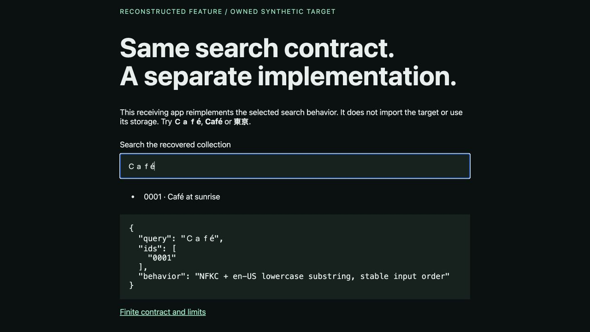
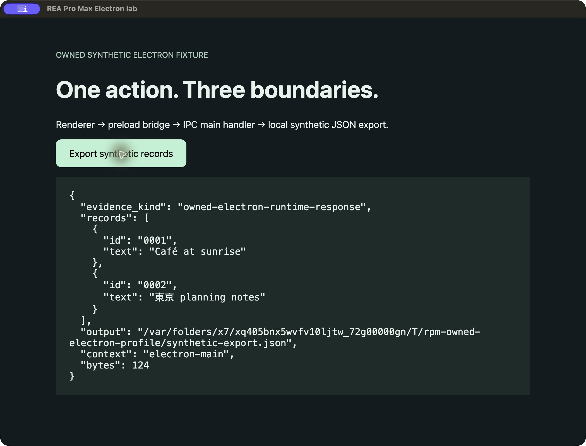

# REA Pro Max — verification record

## v0.8.0 — release verification

On November 18, 2026, the full suite passed **270/270** on macOS arm64 with Node 22.23.0, Chrome for Testing 156.0.8078.4 and the natural-idle test enabled. The default run passed 266 tests and skipped four opt-in browser tests. Lint, documentation, vendored SDK verification, and the extracted archive's CLI and official MCP client checks passed. Both MCP initialization modes discovered 31 tools.

- Apple clang compiled and linked a two-architecture macOS 11 reference and an arm64 macOS 12 candidate. The inspector agreed with `otool` and `lipo`. The forward comparison returned two losses and exited 2. Reversing the same executable inputs returned two gains and exited 0. The packaged object files reproduce both changes.
- OpenJDK javac compiled the same source for Java 11 and Java 17. The bundled policy accepted the byte change and failed the declared Java target check. The standalone comparison and the policy recorded the same comparison digest.
- A separate corpus check supplied all 7,406 class files extracted from the installed OpenJDK 26.0.2 `java.base.jmod` individually to the public inspector. All had major version 70. The inventory contained 6,261 classes, 868 interfaces, 239 enums, 37 annotations and one module descriptor. This measures static input coverage on one distribution.
- Regression tests cover shared JVM and universal Mach-O magic, preview-release transitions, null policy lists, and a verified ZIP member mismatch alongside an unsupported member. The directory entry budget also accounts for pending siblings during enumeration.

[Compiler commands and limits](NATIVE-TARGETS.md) · [Measured receipt digests and corpus identity](evidence/targets-v0.8.json)

The local ZIP contains 127 entries and 1,730,271 bytes, SHA-256 `1bae8b426fba316fa934f14757b0d4bec768a857f453c3025c2a0fd33e0e5010`. The archive checksum was verified after writing. Publication, remote CI, and device or JVM execution are outside this acceptance run.

## v0.7.0 — local release candidate

Tested on November 18, 2026 with Node 22.23.0 and Chrome for Testing 156.0.8078.4 on macOS arm64. The suite passed **245 of 245** with the Chrome executable and natural-idle tests enabled. The default command passed **241 of 245** with four explicit browser skips. Lint, documentation, SDK bundle verification and the extracted package smoke passed. Both legacy MCP initialization and 2026-07-28 discovery exercised 29 tools, including the four new surfaces through the extracted package.

| Acceptance case | Observed result |
| --- | --- |
| Stable interface, changed Wasm body and re-encoded ZIP | The bundled policy passed all four checks. The Wasm raw-file hashes differ, its public declarations match and the ZIP member contents match. |
| Allowed file edit changes the public Wasm return type | The file change check passed and the ABI check failed at `get`. The overall CLI verdict returned exit 2. |
| Incorrect, malformed or missing saved observations | The tests retain wrong-origin counts, reject unexpected HTTP statuses and keep unreadable traces and malformed HARs unknown. Known trace or page errors and scoped unmatched HAR requests fail their checks. |
| Real Playwright import | Playwright Core 1.64.1 recorded a click and resulting fetch on an owned loopback page. The v10 importer recovered six completed actions and two HTTP 2xx resources. The reduced receipt omitted the loopback URL, query marker and response text. |
| End-to-end acceptance with the real trace | The release check passed the admitted HTTP and browser observations and passed the valid build. A deliberate ABI change failed only the ABI check using the same saved observations. The current MCP client returned the same trace and failure receipt digests as CLI. |

The raw browser actions only describe the owned page. The Wasm and ZIP checks read the separate build artifacts. The release check is finite and records saved runtime evidence as reported. [Measured receipt summary](evidence/release-v0.7.json) · [Reproduce the bundled case](RELEASE-CHECK.md) · [Release regression tests](../tests/release-check.test.mjs)

The local `dist/rea-pro-max-0.7.0.zip` contains 117 entries and 1,664,430 bytes. SHA-256 `8e88728d3a47905bb5fa70ce915796c6cccb29ef26dd18ee82c36861611eb105`. Hosted publication, Windows/Linux browser runtime and market comparisons were outside this verification run.

## v0.6.0 — local release candidate

Verified on November 18, 2026 on macOS arm64, Node 22.23.0 and Chrome for Testing 156.0.8078.4. The acceptance gates came from the pinned upstream release review and the independent REA Pro Max workflows. [REA 6.9.0 reference, coverage and examples](REA-6.9.md)

| Gate | Result and reproducible evidence |
| --- | --- |
| Build comparison | The same fixture produces matching CLI and MCP receipts. A repack changes ZIP bytes while preserving member content identity. A deliberate member edit reports the correct file, while partial member evidence leaves absences unresolved. [Artifact comparison tests](../tests/artifact-diff.test.mjs) |
| Archive and firmware structure | ZIP fixtures cover local/central consistency, descriptors, CRC, safe file identity, Zstandard frame bounds and shared decode limits. An independently made Python streaming ZIP was also checked. Intel HEX reports checksum-verified regions, and basic UF2 reports validated blocks. Corrupt, ambiguous and unsupported cases retain explicit evidence. [ZIP tests](../tests/zip.test.mjs) · [Firmware tests](../tests/firmware.test.mjs) |
| API coverage | The bundled synthetic HAR matches two OpenAPI operations. One declaration is unobserved and one HAR row is unmatched. The exported report keeps templates and entry indices. [Contract tests](../tests/api-contract.test.mjs) · [Local fixture](../skills/rea-pro-max/assets/labs/api/openapi.json) |
| Actual MV3 correction | The owned starter failed at `cold-read` after forced worker stop. One SHA-256-bound edit fixed it and replay verified all seven actions, with the reference worker digest preserved. Another run qualified natural idle by observing worker absence, a new boot identity and persisted state. [Recovery engine tests](../tests/recovery-engine.test.mjs) · [Lifecycle tests](../tests/runtime-provider.test.mjs) |
| Actual web comparison | A CSS-only paint change on owned loopback pages altered the screenshot digest. The finite behavioral verdict passed and the visual verdict failed. The built-in capture records DOM, layout and sampled storage keys. Network effects require separately supplied evidence. [Web verification tests](../tests/web-recovery-core.test.mjs) |
| Actual MCP | Official legacy initialization and current 2026-07-28 discovery both passed with 25 tools, including file diff, HAR comparison and browser-enabled capture/replay. A separate in-session fixture matched two literal worker channels to two real same-artifact message events. [MCP checks](../tools/check-mcp.mjs) |
| Package and docs | The packaged skill is reproducible and passed standalone CLI and both MCP client routes after extraction. All nine README selectors and 36 task templates passed the documentation checker. SDK bundle hash and licenses matched the vendor receipt. [Package smoke](../tools/package_skill.py) |

The browser-enabled test suite passed **219 of 219** tests. Standard `npm test` passed **215 of 219** with four explicit browser skips when no executable was supplied. Lint, docs, SDK bundle verification and `git diff --check` passed.

The local `dist/rea-pro-max-0.6.0.zip` contains 105 files and 1,597,685 bytes. SHA-256 `bef4311360940fab5250a74182ed54fb69ab2af6564b705ffa1504ec8685bde3`.

This evidence covers owned fixtures on the stated host. An optional Craft binary was represented by protocol fixtures. Linux/Windows runtime validation, remote release and comparative market performance remain unverified for this candidate.

## v0.4 — web recovery and optional provider boundary

The working tree now reports version `0.4.0` and exposes **21 local MCP tools**. It adds a dependency-free bounded web action provider (`capture_web`/`replay_web`) and an optional typed Craft Anything MCP adapter. The web kernel has a versioned recovery IR, contract compiler, deterministic behavior/visual separation and dependency-aware action reducer. The Craft adapter is tested against a fake newline JSON-RPC MCP server for pinned identity, capability drift, malformed output, byte/time bounds, cancellation, cleanup and workspace path admission; no Craft build or target application was executed during this audit.

On 2026-11-11, the local Node `v22.23.0` suite reports **166 tests, 164 pass and 2 explicit browser skips** when no Chromium executable is configured. `npm run lint`, `npm run check:mcp` and the documentation checks pass. The MCP smoke check exercises both legacy initialization and current discovery with the 21-tool catalog. Web fixture tests cover the owned reference/starter/recovered static apps and pass without network access. Real Chromium web capture/replay remains unverified on this host because no executable was configured; the runtime test records an explicit skip/unknown rather than inferring success.

The reviewed Craft source identity is `storytold/craft-anything` version `0.4.0` at commit `49af55e4e4f4b729152a1e61c845a5b10f7b6d9b`, licensed `MIT OR Apache-2.0`. The adapter retains this identity and fails closed when a supplied binary does not report the pinned commit/version. This is protocol/provider evidence, not evidence that Craft itself was installed, built or run against a target.

## v0.3 — recovery and actual Chromium provider

The v0.3 checkout uses version `0.3.0` and exposes **15 local MCP tools**. It adds explicit unsupported-source coverage, bounded include/exclude scopes, hash-checked source excerpts, a shared descriptor-based JSON reader, current-target CLI binding checks and isolated CLI oracle trials with a hard child-process deadline. The runtime lane is opt-in and provider-specific: it executes the documented `rpm-kv-v1` MV3 extension protocol in a fresh disposable Chromium profile.

The model and receiving suites pass locally. The full suite reports **144 tests, 142 pass and 2 skipped** when no browser environment variable is supplied; the two skips are the explicit real-Chromium tests. Lint, MCP smoke and vendor checks pass.

On 2026-11-06, Chrome for Testing **156.0.8078.4** on macOS arm64 executed the owned fixtures with Node v26.5.0. The starter intentionally failed after a forced worker stop at `cold-read`, while the independently authored `recovered` implementation matched the durable reference. The run also passed six independently authored acceptance families covering persistence, retry after removal, request-ID conflicts, Unicode/prototype keys, invalid input and mutation semantics. Evidence is retained in [recovery-v0.3.json](evidence/recovery-v0.3.json); it is not a market benchmark or universal extension claim.

The natural-idle case waited 35 seconds without polling or attaching a worker debugger. The worker target was absent before wake, the target-reported boot identity changed, and the recovered value remained available. This is a qualified observation for the recorded Chrome build and fixture, not a claim for every browser version or extension.

Browser-enabled MCP smoke passed both legacy initialization and 2026-07-28 discovery. It exercised source evidence, actual capture, starter replay failure and recovered replay pass. The executable is validated at MCP startup; omitting `--browser` keeps runtime disabled.

## v0.2.1 — MCP and documentation

The first v0.2.0 Windows CI run exposed native/short-path workspace aliases and dangling-symlink export behavior. Version0.2.1 canonicalizes the workspace with the native resolver and rejects existing export entries before exclusive creation. The existing real-client security cases exercise both behaviors.

The independent local stdio server exposes15 tools through the bundled official SDK2.4.0 runtime. Official clients exercise both the legacy initialization path and the current2026-07-28 discovery path. The v0.3 suite passes **142 tests with2 explicit browser skips** without a browser environment. This is protocol/client integration evidence, not a claim that a commercial LLM completed a live task in every named host.

Checks include scoped artifact/JSON access; deterministic bounded paging; opaque session handles; portable case export/import; failed-mutation rollback; concurrent revision conflicts; current case-target binding checks; valid finite fail/unknown results; exclusive HTML/JSON exports; cache eviction; input/model/graph bounds; two concurrent heavy operations; stdout discipline and EOF shutdown.

The56-file self-contained archive is extracted outside the repository. Its server runs without node_modules in its installation. Official current and legacy clients repeat capabilities/catalog, static inspection/evidence paging, case export/import, fixed owned lab, finite mismatch verification and standalone report export. The original CLI help/demo/verify path also passes after extraction. The105-test suite and extracted server checks also pass on local macOS arm64 with Node24.22.2; the Node22 and Node24 archive builds are byte-identical.

`npm run check:vendor` regenerates and compares the pinned SDK/schema bundle and retained license bytes. Complete original SDK Apache-2.0/MIT transition licenses and Zod MIT license are included. Development dependencies require npm; the packaged runtime does not.

The main README is expanded; English remains at root and eight substantive translations live under `docs/i18n`. All nine selectors resolve to the same language destinations. The commands distinguish Git/source archives from the packaged skill ZIP layout. Localization has no professional human/native-speaker review.

For current remote CI status, use [Actions](https://github.com/hieunguyenak92/rea-pro-max/actions). The release publication report records actual remote results separately; a configured matrix is not a completed run. Existing real-app fixture observations below were collected for v0.1 and are retained as dated examples.

## Reproduce the engine checks

```sh
npm ci --ignore-scripts
npm test
npm run lint
npm run check:docs
python3 tools/package_skill.py --check
```

The original v0.1 local Node26 run passed **82 tests** with no skips. The v0.2 local Node22 suite passes **105 tests** with no skips. The suite covers artifact parsing without execution, context/alias ambiguity, conservative unknowns, bounded graph expansion, revision conflicts, stale bindings, finite behavior comparison, event ordering, reset-aware failure reduction, CLI exit codes, inert report embedding and extracted/linked installation paths. A Windows host may skip symlink-only checks when its account lacks symlink privileges. Remote CI status is visible in [Actions](https://github.com/hieunguyenak92/rea-pro-max/actions); the prepared matrix is Node22/24 on Linux/macOS/Windows. Do not infer remote success from this local record.

The skill ZIP is built twice from the same source and checked byte-for-byte. It is extracted outside the checkout; `help`, `demo` and `verify` run without npm, Electron or an upstream REA installation. Internal checksums cover its entries. Release checksums bind bytes, not the truth of imported observations.

## Controlled persistence lab

`demo --out ./rpm-lab` executes this repository's two owned worker scripts in Node VM contexts with simulated Chrome message/storage APIs. It does not execute an arbitrary inspected target.

- Static inspection separates manifest, popup, content-script and worker contexts. Edges retain declared/candidate authority.
- A declared popup-reopen probe has no distinguishing gain for the two known storage explanations. A worker-context reset is ranked first. An unmodeled explanation remains possible.
- The same five actions expose the intentionally faulty worker's lost clips. Persistent writes are recorded as modeled effects.
- The reducer retains `save → restart → read`, with the original mismatch fingerprint, 22 oracle attempts and tested one-minimality. This is not a globally shortest proof.
- A receipt self-comparison exercises the passing verifier path. It is a control, not an independently rebuilt application.

Workers, actual action sequence, reset implementation, Node toolchain and verifier/common source are hashed into model bindings. These are reproducible content identities. The model remains a model.

The [recorded explorer](https://hieunguyenak92.github.io/rea-pro-max/#explorer) reads saved outputs from these operations. It does not attach to a browser or run live target probes.

## Actual web and reconstructed-feature observations

The owned web fixture was served on loopback and exercised through a real in-app browser:

| Action | Visible result |
| --- | --- |
| Search `Ｃａｆé` | NFKC-normalized `café`; record `0001` |
| Search `東京` | Record `0002` |
| Add synthetic note, then reload | Record `0004` retained |

A separate [receiving implementation](../examples/recovered-search/CONTRACT.md) reconstructs only the selected search behavior. It was launched separately and returned `0001` for decomposed `Café` and fullwidth `Ｃａｆé`. Nine finite component checks include accent significance, untrimmed spaces, stable order, duplicates and leading-zero IDs.

This is one worked task authored and checked by the same agent with access to the supplied source fixture. It is not blinded, filesystem-isolated, statistically representative or evidence of a causal performance improvement from installing a skill.



## Actual Electron observation

The owned fixture ran in official npm Electron45.2.2 on macOS arm64. Clicking **Export synthetic records** traversed renderer → preload bridge → `ipcRenderer.invoke` → main handler. The visible main-process response reported a 124-byte local JSON export. Reading that file confirmed two records, including `0001` and `東京`. The inspector separately identified main/preload and candidate IPC boundaries without launching the target; it does not infer runtime causality from those static links.



## Explicitly unverified runtime claims

The v0.3 owned MV3 provider has qualified forced-stop and natural-idle observations on the recorded Chrome for Testing build above. This does not generalize to arbitrary MV3 extensions or every browser/platform. The provider requires the `rpm-kv-v1` response envelope and does not collect every UI/network/file effect. Missing boot evidence, incomplete cleanup or a different browser environment produces incomplete/unknown evidence.

No Android, Apple-device, native-binary, managed-code, Flutter, React Native or WebAssembly semantic provider was exercised. Those task prompts require appropriate host tools. The release does not bundle universal decompilation or certify those integrations. The earlier multi-task evaluation design is a plan, not a completed benchmark.

## Support boundary

Static JavaScript/MV3/extracted Electron analysis and provider-neutral case/planner/verifier/reducer/report machinery are shipped. Input files, AST parsing, contexts, graph records and analysis occurrences have explicit limits; exceeding a hard graph limit fails with `analysis_bounds` so a caller can narrow the artifact. Imported runtime observations retain their stated provenance. A finite pass concerns only comparable supplied cases.

Local reports were checked for navigation, filters, record selection and JSON download; the public landing explorer was checked at desktop and narrow viewport sizes. Screenshots show actual pages/apps, not generated product mockups. Localization has not received a professional human/native-speaker review.
