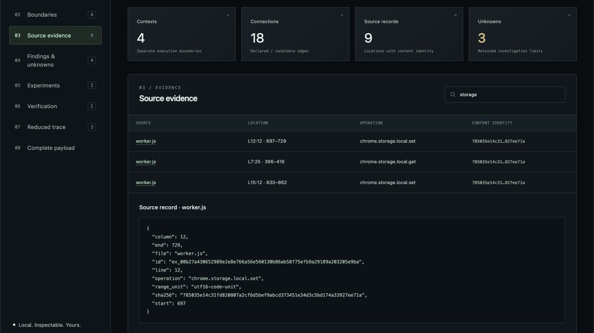
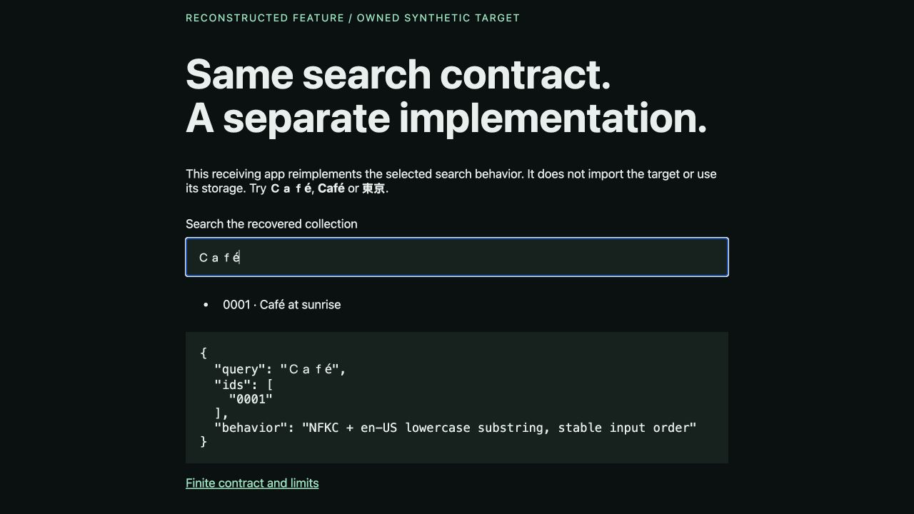
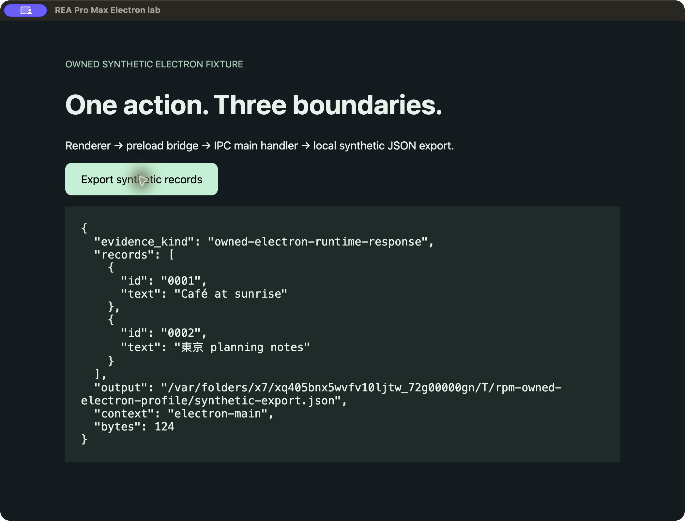

# REA Pro Max

**理解机制。重建行为。验证结果。**

面向 Claude Code、Codex 和兼容 MCP 客户端的独立逆向工程工具集，提供本地 MCP、智能体技能和直接运行的 CLI。将陌生的应用、扩展程序或 Web 功能，转化为可以解释的机制、可以运行的实现，以及可以核验的有限行为契约。

[English](../../README.md) · [Tiếng Việt](vi.md) · [한국어](ko.md) · [日本語](ja.md) · [Español](es.md) · [Português](pt-BR.md) · [简体中文](zh-CN.md) · [ไทย](th.md) · [Français](fr.md)

[探索已记录的实验](https://hieunguyenak92.github.io/rea-pro-max/#explorer) · [安装技能](../INSTALL.md) · [验证记录](../VALIDATION.md) · [发行版本](https://github.com/hieunguyenak92/rea-pro-max/releases)




*这是使用模拟 Chrome API 的 JavaScript 模型所生成的真实报告，不是真实 Chromium 生命周期的证据。*

## 让保存经得住真正的 worker 重启

活跃会话中的演示可能掩盖数据丢失。v0.3 创建可运行的接收项目：starter 能保存，也能通过重新打开页面的检查，但 Chromium 真正停止并唤醒 worker 后，已确认的值就会丢失。

```sh
node skills/rea-pro-max/scripts/rea-pro-max.mjs recovery init --out ./recovery-work
node skills/rea-pro-max/scripts/rea-pro-max.mjs runtime doctor --browser "$RPM_BROWSER"
node skills/rea-pro-max/scripts/rea-pro-max.mjs recovery replay --reference ./recovery-work/reference --candidate ./recovery-work/starter --scenario ./recovery-work/scenario.json --browser "$RPM_BROWSER" --out ./before.json
```

将 `RPM_BROWSER` 设为已安装且支持加载解压扩展的 Chromium/Chrome for Testing 可执行文件绝对路径。工具不会自动下载浏览器。首次 replay 会有意返回 exit `2`，指出不一致操作，并保留两次执行的证据。让智能体依据 `starter/contract.json` 修复 `starter/worker.js`，再用新的输出路径重放。`recovered/` 是独立编写、可以运行的接收实现示例。

**交付物是可以运行的代码，以及可以核验的证据。** 该 provider 目前只检查文档化的 `rpm-kv-v1` 消息协议和选定的重置边界，不会自动重建任意扩展。原始证据保留 boot ID；比较时仅排除这一已声明的观察字段。消息 receipt 不证明未观察的 UI、网络或文件副作用。

MCP 提供 **15 个工具**。运行时默认关闭；注册服务器时追加 `--browser "/absolute/path/to/chromium"`，即可启用 `capture_feature` 与 `replay_feature`。它们使用独立临时 profile；宿主智能体仍负责修复代码。`read_source_evidence` 返回有大小限制且经过 hash 检查的源码片段。include/exclude 和 coverage 会列明纳入、排除、未解析的文件；尚未提供 TypeScript/JSX 语义解析。

[恢复流程与限制（英文）](../RECOVERY.md) · [按版本验证](../VALIDATION.md)。`shrink` 每次尝试都在有期限的新子进程中执行 oracle；外部状态由 oracle 的 `reset()` 负责。新 profile 和子进程不是操作系统或网络沙箱。

## 一个像样的界面，只是起点

真正困难的是点击之后发生了什么：哪个上下文接收消息，状态保存在哪里，取消操作究竟中断什么，调用方会收到哪种错误，以及为什么重建的功能到了第二次使用就出问题。

REA Pro Max 把这些问题带入实现过程。分析已分发的 JavaScript，明确相互竞争的解释，选择能区分它们的实验。在你的项目中实现所需行为，比较实际输出、状态变化和事件。发现不一致后，将它缩减为仍能复现同类故障的操作序列。

**交付物是你要求的、能够运行的功能，并附带证据。** 宿主智能体负责代码开发和运行时操作；内置工具提供可执行的分析、实验排序、行为验证与故障缩减机制。

## 直接交付任务，无需先学一套新流程

[安装](../INSTALL.md)后，在 Claude Code 中自然地提出需求：

```text
/rea-pro-max 调查这个扩展的保存与恢复机制，并在我的项目中实现。追踪 popup、content script、worker 和 storage 的边界。在确认 worker 确实重新启动的条件下检查持久性，保留错误行为，并交付可运行代码、实际检查过的用例与尚未验证的部分。
```

在 Codex 中选择该技能，或在同样的任务前加上 `$rea-pro-max`。提供目标和接收代码的项目，智能体会编写内部 case 文件。观察真实浏览器、应用或设备，需要宿主具备对应工具。

- **重建指定功能：** 涵盖顺序、错误、取消和持久化边界。
- **理解 MV3 扩展：** 区分 popup、content、page 与 worker 上下文。
- **恢复 Electron 边界：** 分析已提取的 main、preload、renderer 源码。
- **解释两个构建之间的回归：** 对照可比较的输入和可观察效果。
- **缩减可复现故障：** 减少操作步骤，同时保留故障身份。

## 一套工具，三种起步方式

**v0.3 提供 15 个本地 MCP 工具**，增加可选的真实 Chromium capture/replay，以及经过 hash 检查的源码片段。技能引导智能体交付可运行实现；CLI 共用同一内核，使用时无需安装 npm 依赖。

### 将 MCP 连接到 Claude Code 或 Codex

请把绝对路径替换为实际路径。workspace 必须已存在，并包含所需目标和输出位置。以下是供你执行的配置命令；产品不会自动修改其他应用的配置。

**以下命令的路径采用 Git checkout 目录结构。** Releases 中打包的技能 ZIP 解压后，`rea-pro-max/` 本身就是技能根目录：在其中运行 `node scripts/rea-pro-max.mjs demo --out ./rpm-lab`，MCP 使用 `/absolute/path/to/rea-pro-max/scripts/mcp-server.mjs`，安装技能时复制整个文件夹。[目录结构与 ZIP 命令（英文）](../INSTALL.md#choose-your-package-layout)。GitHub 自动生成的 Source code 归档仍采用 checkout 结构。

```sh
claude mcp add --transport stdio --scope local rea-pro-max -- node "/absolute/path/to/rea-pro-max/skills/rea-pro-max/scripts/mcp-server.mjs" --workspace "/absolute/path/to/your-workspace"
```

```sh
codex mcp add rea-pro-max -- node "/absolute/path/to/rea-pro-max/skills/rea-pro-max/scripts/mcp-server.mjs" --workspace "/absolute/path/to/your-workspace"
```

重新连接宿主，检查工具列表，然后让智能体调用 `get_capabilities`。若桌面应用的 PATH 不同，请使用 Node 可执行文件的绝对路径。英文 [MCP 指南](../MCP.md)提供 JSON 配置、参数、限制与错误处理说明。

服务器通过本地 stdio 通信。直接启动时会等待 MCP 消息，不会显示交互界面：

```sh
node /absolute/path/to/rea-pro-max/skills/rea-pro-max/scripts/mcp-server.mjs --workspace /absolute/path/to/your-workspace
```

### 安装技能，自然地交付任务

将**整个** `skills/rea-pro-max` 文件夹复制到 Claude Code 项目的 `.claude/skills/rea-pro-max`，或 Codex 项目的 `.agents/skills/rea-pro-max`。`lib`、`scripts`、`references`、`assets` 都是可执行系统的一部分，只复制 `SKILL.md` 会缺失实际机制。

随后在 Claude Code 使用 `/rea-pro-max`，或在 Codex 选择技能、提及 `$rea-pro-max`。英文 [INSTALL.md](../INSTALL.md)包含防覆盖复制命令、个人安装位置和 Windows 说明。

### 直接运行 CLI

下方演示无需 MCP 即可运行。根据现有环境选择技能、MCP 或 CLI；原版 REA 服务器不是前提。

## MCP 工具：从产物到可交付结果

| 工具 | 任务 |
| --- | --- |
| `get_capabilities` | 查看版本、workspace、范围、限制和执行策略。 |
| `inspect_artifact` | 静态分析范围内的目标，通过句柄保留完整结果。 |
| `read_artifact` | 按节或分页读取，避免反复返回整个图。 |
| `read_source_evidence` | 按证据读取有大小限制且经过 hash 检查的源码片段。 |
| `capture_feature` | 启用运行时后，在真实 Chromium 中采集 MV3 场景。 |
| `replay_feature` | 分别执行参考与接收扩展，保留判定和不一致证据。 |
| `create_case` | 根据实际检查目标的身份创建 case。 |
| `revise_case` | 验证补丁与预期 revision 后再更新。 |
| `record_observation` | 保留观察、来源、authority 与声明的 bindings。 |
| `rank_probes` | 为允许的实验排序，不执行实验。 |
| `verify_behavior` | 按有限契约比较观察记录文件。 |
| `export_artifact` | 在 workspace 新文件中导出 JSON 或独立 HTML。 |
| `run_owned_lab` | 只运行同梱自有 worker 的受控模型。 |
| `list_task_prompts` | 按家族与分页浏览 36 个模板。 |
| `import_case` | 验证已导出的 case JSON 并恢复调查。 |

句柄是进程内存中的不透明标识。缓存有上限；重启或条目被淘汰后，应导入保存的 case 或重新分析。使用 `read_artifact` 读取所需部分。客户端发现的实际 schema 是准确的参数契约。

MCP 将客户端路径限制在 workspace 内，拒绝符号链接且不覆盖输出。仅在服务器启动时配置 `--browser` 后，专用工具才会在临时 profile 中执行符合协议的 MV3 扩展。没有任意 shell 或 oracle 工具。这是工具策略，不是操作系统或网络沙箱。

## 相信承诺之前，先运行它的机制

需要 **Node.js 22+**。内置工具可直接运行，无需 API 密钥、`npm install` 或原版 REA 服务器。

```sh
git clone https://github.com/hieunguyenak92/rea-pro-max.git rea-pro-max
cd rea-pro-max
node skills/rea-pro-max/scripts/rea-pro-max.mjs demo --out ./rpm-lab
```

在浏览器中打开 `rpm-lab/report.html`。项目自有的合成实验，在**使用模拟 Chrome API 的受控 JavaScript 模型**中执行参考 worker 和回归 worker。分析、实验排序、不一致检测和操作缩减均为内核的实际输出。这并不能证明真实 Chromium worker 的暂停行为。独立完成的运行时检查会记录在[验证记录](../VALIDATION.md)中。

也可以自行分析附带的产物：

```sh
node skills/rea-pro-max/scripts/rea-pro-max.mjs inspect ./rpm-lab/fixtures/mv3/reference --out inspection.json
node skills/rea-pro-max/scripts/rea-pro-max.mjs report inspection.json --out inspection.html
node skills/rea-pro-max/scripts/rea-pro-max.mjs prompts --target mv3
```

请使用新的输出路径：工具不会静默覆盖已有结果。宿主设置和更多命令见英文[安装与 CLI 指南](../INSTALL.md)。

## 专业能力，应当体现为可检查的机制

| 能力 | 为调查增加的价值 |
| --- | --- |
| 产物边界分析 | Acorn AST 解析、独立执行上下文、候选通信边、精确源码位置和内容摘要。`inspect` 不执行目标代码。 |
| 竞争性解释 | 明确假设、预测与重置感知的探测步骤，避免仅因第一个解释听起来合理就下结论。 |
| 保守的实验排序 | 按声明成本计算最坏情况下可排除的假设数，再按能力、允许的效果和预算筛选。缺失预测始终保持未知。 |
| 绑定观察证据 | 通过目标、场景、重置和工具链身份，将不兼容的观察排除在当前推断之外。哈希标识内容，不证明运行事实。 |
| 有限行为验证 | 对输出、状态、效果和轨迹给出 `pass`、`fail`、`unknown`，保留重复事件与有意义的顺序。 |
| 故障序列缩减 | 在预算内删除操作，重复检查 oracle，并保持稳定的故障指纹。不承诺全局最短序列。 |
| 本地工作台 | 独立 HTML，提供真实搜索、上下文筛选、证据选择和完整 JSON 导出；无需后端或 CDN。 |
| 36 个任务提示词 | 覆盖 Web、扩展、桌面和移动端家族，并明确前提条件。有模板不等于已验证对应 provider。 |

规划器选择下一步该问什么，不会自行执行探测。验证器比较提供的观察，不会独立认证运行时确实执行过。技能会指导宿主智能体完成这些实际操作并保留证据。

## 边界清楚，结果才有明确含义

**v0.3 内置分析：** JavaScript 文件，以及已提取的 Web、Manifest V3、Electron 源码。动态表达式、不支持的语法、缺失 import 和资源限制会明确出现在结果中。

**与 provider 无关的内核：** case 管理、实验排序、有限行为比较、序列缩减和本地报告。`shrink` 会明确执行你提供并控制的 `.mjs` oracle 模块。

**通过宿主工具开展的高级工作流：** 提示词库包含 native、managed、Android、Apple、React Native、Flutter、Tauri 和 WebAssembly 任务。深度分析取决于实际可用且适合目标的工具。本版本没有内置通用反编译器、移动运行时、万能包提取器或语义恢复引擎。格式检测或任务模板不等于经过验证的集成。

CLI/MCP 不上传遥测，也不调用模型 API。静态操作在本地处理；可选运行时使用 loopback 调试连接，浏览器或扩展可按自身权限访问网络。AI 宿主遵循自己的政策。请阅读[隐私与执行边界（英文）](../PRIVACY.md)。

## 最终留下什么

重建任务应交付可运行源码及启动方式、选定的行为契约、实际执行的操作、JSON 证据和剩余限制。有限的 `pass` 仅适用于检查过的用例，不代表整个应用等价。

实验导出 `inspection.json`、`case.json`、`planner.json`、`reference.json`、`candidate.json`、`verification.json`、`reduction.json`、`lab.json` 和独立的 `report.html`。你可以单独检查记录，随项目保存，并在工作台中导出完整 JSON。

## 可以复查的真实示例

**Unicode 搜索：** [接收端实现](../../examples/recovered-search/CONTRACT.md)重建自有 Web fixture 的选定契约：NFKC、按 locale 转小写、子串匹配、稳定记录顺序和字符串 ID。参考与接收端应用分别启动。有限用例和限制记录于 [VALIDATION.md](../VALIDATION.md)。这是同一智能体在可访问源码的条件下编写并检查的示例，不是盲测，也不是技能因果效果基准。



**Electron 导出：** 自有 fixture 实际经过 renderer → preload → `ipcRenderer.invoke` → main，随后读取本地 JSON 文件。静态连接保持 candidate 级别，运行观察才对应实际执行的操作。



## 内核中的专业决策

实验分数等于最坏情况下可排除的假设数除以声明成本，排序前先应用能力、允许效果和预算筛选。当所有假设都与合格观察矛盾时，可返回 `model_incomplete`；没有可区分的允许实验时，可返回 `no_discriminating_probe`。不确定性不会被变成没有依据的置信百分比。

验证器只允许归一化明确的 metadata 路径，不能抹去 output/state/effects/trace 的差异。全序或按 channel 的契约保留重复事件和有意义的顺序。缩减器重复检查 oracle，支持每次尝试前重置，并保持同一故障指纹；最小性仅适用于实际检查的删除操作。

## 常见问题与排障

**必须同时安装 MCP 和技能吗？** 不必。MCP 提供结构化工具，技能提供任务指导，CLI 也能直接运行。

**技能会写出功能吗？** 它指导宿主智能体在你的项目中实现并启动功能。仅交付报告不算完成重建请求。

**关闭 MCP 后 case 还在吗？** 关闭前导出 JSON，在新会话中使用 `import_case`。句柄不会跨进程保留。

**为什么是 `unknown`？** 检查不完整的记录、不可比较的输入，以及 scenario/reset/toolchain/verifier 的 bindings。不会自动将其改为 `pass`。

| 问题 | 下一步 |
| --- | --- |
| MCP 无法启动 | 检查 Node22+、绝对路径和已存在的 workspace。 |
| 看不到工具 | 重新连接，检查服务器状态与 MCP 权限。 |
| 句柄不可用 | 重启或缓存淘汰后导入保存的 case，或重新分析。 |
| revision 冲突 | 读取最新 case，使用其实际 revision。 |
| 资源超限或范围外路径 | 缩小产物范围，或选择正确的 workspace。 |
| 输出已存在 | 使用新文件名，保留之前的证据。 |

后续方向包括：在明确不确定性的前提下深化静态解析，增加可复现的功能恢复示例，以及为能实际运行验证的 provider 建立按版本的集成。这些是路线方向，不代表已经发布的支持。

英文技术资料：[技能说明](../../skills/rea-pro-max/SKILL.md) · [目标范围](../../skills/rea-pro-max/references/target-analysis.md) · [Case 格式](../../skills/rea-pro-max/references/case-format.md) · [验证契约](../../skills/rea-pro-max/references/verification.md) · [任务提示词](../../skills/rea-pro-max/references/prompt-library.md)。

REA Pro Max 为独立开发项目。研究灵感和依赖声明见[致谢](../../THIRD_PARTY_NOTICES.md)；原版 REA 不是必需依赖。[MIT 许可证](../../LICENSE)。

**带来一个值得理解的功能，带走一个可以核验的结果。**
